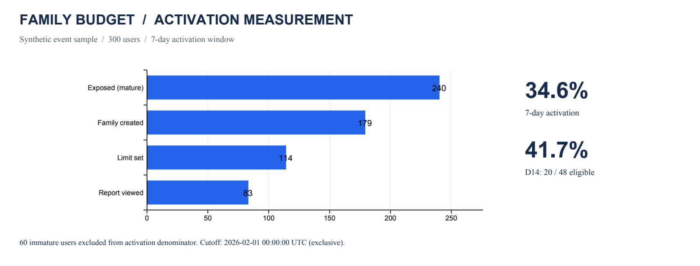

# Семейный бюджет: продуктовый кейс и SQL-метрики · School 21

**Илья Бочаров · бизнес-анализ · продуктовая аналитика · SQL · Python**

Как проверить, что пользователь настроил семейный бюджет и продолжает им пользоваться? Кейс связывает требования к MVP, пользовательский сценарий, события аналитики и воспроизводимый расчёт активации и D14 retention.

**Результат работы:** спецификация MVP, критерии приёмки, бюджет, реестр рисков и SQL-анализ демонстрационных событий.



## Задача и контекст

**Задача:** определить требования к MVP и реализовать воспроизводимый расчёт активации и D14 retention. [Полная постановка и критерии готовности](TASK.md).

Пользователю нужен общий обзор семейных трат и понятный способ ограничить расходы по категории. MVP включает семейную группу, роли владельца и участника, лимиты по категориям, уведомления и сводный отчёт. Совместные цели, персональные рекомендации и веб-версия вынесены за пределы MVP.

## Что можно посмотреть

| Материал | Что показывает |
|---|---|
| [Требования и критерии приёмки](docs/product-spec.md) | Границы продукта, роли, сценарии и проверяемое поведение |
| [План аналитики](docs/measurement-plan.md) | События, единицы анализа, временные окна и ограничения метрик |
| [SQL расчёта](sql/user_metrics.sql) | Упорядоченная воронка, удаление повторных доставок, зрелость когорт |
| [Бюджет MVP](reports/family_budget_estimate.xlsx) | Трудозатраты по ролям, резерв и фиксированные затраты |
| [Риски и условия расширения пилота](docs/delivery-plan.md) | Зависимости, условия приёмки и передачи в сопровождение |

## Демонстрационный расчёт

Расчёт на синтетическом наборе событий. Срез: **до 1 февраля 2026, 00:00 UTC**, исключая эту отметку времени.

| Метрика | Результат |
|---|---:|
| Пользователи, которым показали функцию | 300 |
| Пользователи с полным 7-дневным окном | 240 |
| Завершили последовательность активации | 83 |
| Активация за 7 дней | 34,6% |
| Активированные пользователи с полностью наблюдаемым D14 | 48 |
| Вернулись в календарный день D14 | 20 |
| D14 retention | 41,7% |

60 пользователей исключены из знаменателя активации из-за неполного окна наблюдения. Повторные доставки одного события не увеличивают число пользователей.

## Аналитические решения

- Активация требует последовательности «создал группу → установил лимит → открыл отчёт» в течение 7 суток после показа функции. Показ функции входит в знаменатель.
- Единица анализа — пользователь-владелец, которому впервые показали сценарий создания группы. Участники, приглашённые в уже созданную группу, требуют отдельной воронки.
- D14 считается только после полного завершения четырнадцатого календарного дня с момента активации, по UTC.
- События проверяются по времени совершения, а не по порядку строк. Повторный `event_id` с разными данными вызывает ошибку.
- При пустом знаменателе результат недоступен (`null`), а не равен 0%.

Следующий шаг для пилота — проверить полноту событий и связь выбранной активации с последующим использованием продукта.

## Запуск

Структура репозитория:

```text
TASK.md    — постановка задачи и критерии готовности
docs/      — требования, метрики, бюджет и план реализации
data/      — демонстрационные события и параметры сметы
sql/       — схема данных и запрос расчёта метрик
src/       — генерация данных, запуск анализа и график
tests/     — проверки последовательности событий и окон
reports/   — результаты, график и Excel-смета
```

Python 3.10+ со встроенной SQLite 3.25+; для расчётов не нужны внешние библиотеки.

```bash
python3 src/analyze.py
python3 -m unittest discover -s tests -v
```

Данные уже включены. Для повторной генерации того же набора:

```bash
python3 src/generate_demo.py
python3 src/analyze.py
```

Для другого среза или собственного совместимого датасета:

```bash
python3 src/analyze.py --as-of "2026-01-20 00:00:00" --out reports/earlier_cutoff
```

График обновляется отдельно: `python3 -m pip install -r requirements-viz.txt`, затем `python3 src/plot.py`. Таблица выше — снимок демонстрационного расчёта и не обновляется автоматически.

[Источники и методика подготовки данных](docs/provenance.md).
